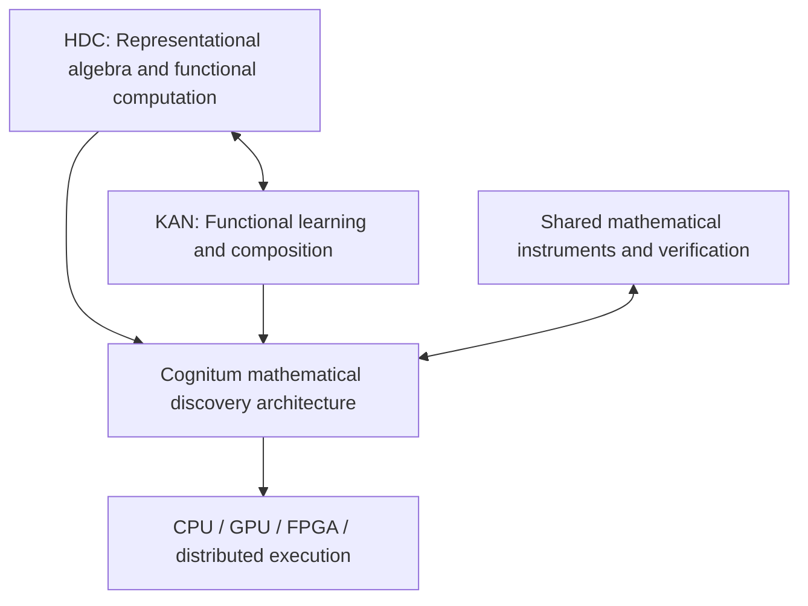
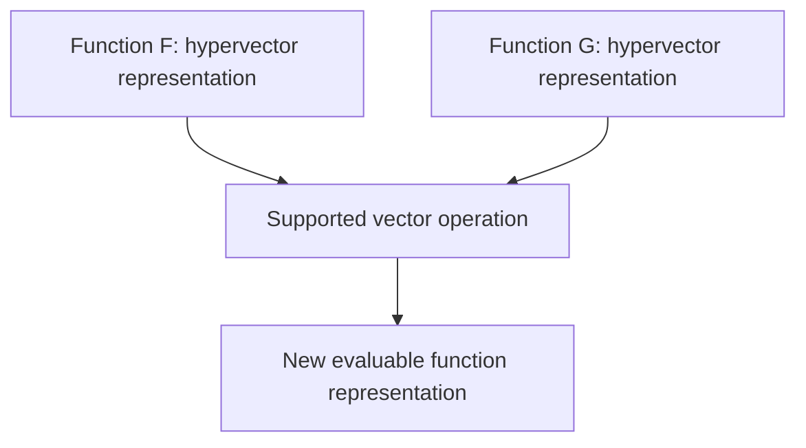
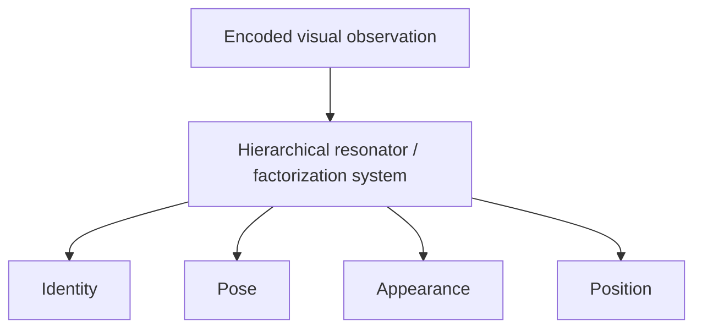
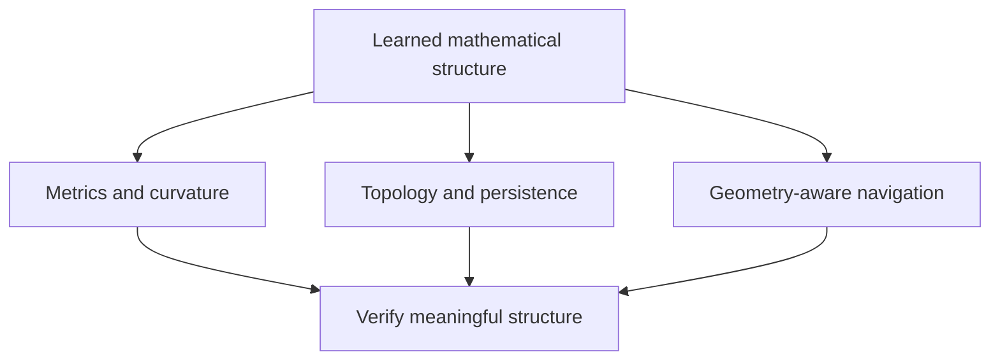
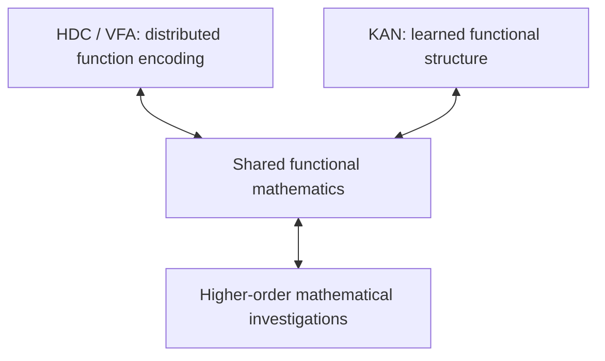

# Cognitum — HDC & KAN Master Mathematical Capability Register

**Both HDC and KAN must be developed as comprehensive mathematical computing subsystems, not narrowly constrained machine-learning algorithms.**

**Purpose:** Consolidate the full conceptual scope for mathematical foundations, architecture variants, representational capabilities, learning mechanisms, computational operations, scientific applications, interoperability and physical execution. This register is a proposed research and engineering scope, not an assertion that Cognitum already implements these capabilities.

**Date:** November 18, 2026

## Governing principles

- **Established:** Supported by existing mathematical theory or published demonstrations.
- **Experimental:** Investigated in research but not generally solved.
- **Proposed:** A broader capability or integration Cognitum could investigate.

Completeness means accounting for every major known capability, documenting its limitations and maintaining an extensible register as new mathematics becomes available. No finite list can guarantee coverage of all future discoveries. The objective is **maximum mathematical fidelity, capability and robustness before premature computational optimization**.

Neither engine is subordinate to the other. Preserve independent mathematical development, overlapping capabilities and principled interoperability.

## Contents

1. [Comprehensive HDC architecture — H1–H60](#part-i--comprehensive-hdc-architecture)
2. [Comprehensive KAN architecture — K1–K60](#part-ii--comprehensive-kan-architecture)
3. [Shared mathematical investigation infrastructure](#part-iii--shared-mathematical-investigation-infrastructure)
4. [HDC and KAN mathematical interoperability — I-01–I-20](#part-iv--hdc-and-kan-mathematical-interoperability)
5. [External intelligence integrations](#part-v--external-intelligence-integrations)
6. [Applications across Cognitum, NVP and Lu](#part-vi--applications-across-projects)
7. [Physical computation and hardware](#part-vii--physical-computation-and-hardware)
8. [Mathematical robustness requirements](#part-viii--mathematical-robustness-requirements)
9. [Consolidated scope](#part-ix--consolidated-scope)
10. [Foundational research literature](#part-x--foundational-research-literature)
11. [Master engineering directive](#master-directive-for-the-cognitum-engineering-conversation)

---

# Part I — Comprehensive HDC architecture

## H1. All major representational architectures

Cognitum should investigate the mathematical strengths of each representation rather than prematurely committing every operation to a single encoding.

| Architecture | Mathematical foundation |
|---|---|
| BSC | Binary Spatter Codes |
| MAP | Multiply-Add-Permute algebra |
| HRR | Holographic Reduced Representations |
| FHRR | Fourier Holographic Reduced Representations |
| GHRR | Generalized Holographic Reduced Representations |
| TPR | Tensor Product Representations |
| SBDR | Sparse Binary Distributed Representations |
| MBAT | Matrix Binding of Additive Terms |
| BSDC | Binary Sparse Distributed Codes |
| MCR | Modular Composite Representations |
| VTB | Vector-derived Transformation Binding |
| GA-VSA | Geometric algebra representations |
| VFA | Vector Function Architectures |
| RHC | Residue Hyperdimensional Computing |
| SSP | Spatial Semantic Pointers |
| SPA | Semantic Pointer Architecture |
| NVSA | Neuro-vector-symbolic architectures |
| SDM | Sparse Distributed Memory, as complementary infrastructure |

These include core VSA models, specialized extensions and related architectures. Their operations are not necessarily interchangeable. See references in Part X, especially the HDC/VSA surveys, VFA and residue arithmetic papers.

## H2–H10. Mathematical foundations

| Group | Required exploration |
|---|---|
| **H2 — Abstract algebra** | Groups, rings, fields, semirings, modules, identities, inverses, associativity, distributivity, noncommutative operations |
| **H3 — Linear algebra** | Vector spaces, inner products, projections, orthogonality, matrices, eigenvectors, singular-value decomposition |
| **H4 — High-dimensional geometry** | Hyperspheres, quasi-orthogonality, concentration of measure, distance metrics, intrinsic dimensionality, geometric separation |
| **H5 — Probability theory** | Random vectors, similarity distributions, collision probabilities, concentration inequalities, retrieval uncertainty |
| **H6 — Information theory** | Entropy, mutual information, information capacity, compression, information loss, rate-distortion analysis |
| **H7 — Coding theory** | Error correction, redundant representations, codebook design, corruption recovery, minimum-distance analysis |
| **H8 — Harmonic analysis** | Fourier transforms, phase encoding, spectral measures, convolution, correlation, complex representations |
| **H9 — Kernel mathematics** | Positive-definite kernels, kernel approximation, random Fourier features, RKHS, kernel geometry |
| **H10 — Tensor and geometric algebra** | Tensor products, tensor contractions, tensor decomposition, Clifford algebra, rotations, structured binding |

The theoretical framework must establish when the intended algebra is valid, when an operation is approximate and when information becomes unrecoverable. Existing theoretical HDC research provides a starting point for capacity and learning guarantees.

## H11. Fundamental HDC operations

| Operation | Purpose |
|---|---|
| Binding | Associate constituents |
| Unbinding | Recover constituents |
| Bundling | Superimpose information |
| Unbundling | Attempt to recover bundled components |
| Permutation | Encode ordering and positional roles |
| Inverse permutation | Reverse positional transformations |
| Scalar weighting | Assign relative contribution |
| Normalization | Control representation magnitude |
| Similarity measurement | Compare representations |
| Cleanup | Recover known symbols from noisy estimates |
| Projection | Transform between representational spaces |
| Matrix binding | Encode structured transformations |
| Conjugation | Support inverse operations in compatible algebras |
| Fractional power encoding | Represent continuous coordinates |

## H12–H19. Information representation and memory

| Group | Capabilities |
|---|---|
| **H12 — Fundamental encoding** | Symbols, numbers, categories, continuous variables, intervals, multidimensional observations, multidimensional coordinates |
| **H13 — Structured encoding** | Records, dictionaries, attribute-value pairs, tuples, sets, multisets, ordered lists |
| **H14 — Hierarchical encoding** | Trees, nested objects, part-to-whole relationships, recursive structures, compositional hierarchies |
| **H15 — Relational encoding** | Directed relationships, role binding, triples, typed relations, n-ary relations, relationships about relationships |
| **H16 — Associative memory** | Content-addressable retrieval, partial-cue recall, pattern completion, contextual retrieval, inverse queries |
| **H17 — Memory organization** | Working memory, short-term memory, long-term memory, episodic memory, semantic memory, procedural representations |
| **H18 — Memory evolution** | Incremental insertion, selective updates, deletion, consolidation, conflict retention, versioning |
| **H19 — Memory navigation** | Hierarchical retrieval, association traversal, semantic neighborhoods, similarity search, cross-domain navigation |

Some of these higher-level memory capabilities require persistent records and additional learning algorithms. A hypervector alone does not automatically provide every type of memory.

## H20–H24. Continuous mathematical computation — VFA

**This must be a major subsystem, not an auxiliary HDC feature.**

Vector Function Architectures provide a mathematical framework connecting randomized distributed representations to continuous functions and kernel methods. See [Computing on Functions Using Randomized Vector Representations](https://arxiv.org/abs/2109.03429).

| Group | Capabilities |
|---|---|
| **H20 — Function representation** | Univariate functions, multivariate functions, continuous fields, periodic functions, kernel functions, complex-valued functions |
| **H21 — Function construction** | Kernel superposition, regression, interpolation, approximation, learned coefficients, function reconstruction |
| **H22 — Fundamental functional algebra** | Addition, subtraction, scalar multiplication, scalar division, translation, convolution, correlation |
| **H23 — Extended functional algebra** | Differentiation, integration, pointwise multiplication, pointwise division, function composition, functional inversion |
| **H24 — Higher-order mathematics** | Function-space distances, functional similarity, projections, operator representations, functional optimization, function-valued mappings |

The extended operations must have a mathematical specification, including closure conditions and approximation bounds. For example, function division requires restrictions around zeros, and pointwise multiplication is not equivalent to ordinary FHRR binding. Even differentiation, while analytically straightforward for finite Fourier-feature representations, can amplify high-frequency errors.

## H25–H27. Arithmetic and numerical computing

| Group | Capabilities |
|---|---|
| **H25 — Residue arithmetic** | Integer encoding, modular addition, subtraction, multiplication, Chinese remainder reconstruction, carry-free arithmetic |
| **H26 — Extended numerical representation** | Signed quantities, rational-number schemes, fractional encodings, scaling, range extension, overflow detection |
| **H27 — Numerical algebra** | Approximate numerical operators, dot products, matrix-vector operations, transformations, iterative numerical computation |

Residue HDC offers a genuine distributed arithmetic framework. However, exact recoverability depends on the representable range and successful decoding. Division and nonmodular arithmetic require additional treatment.

## H28–H32. Factorization and disentanglement

This is the research direction particularly relevant to NVP.

| Group | Capabilities |
|---|---|
| **H28 — Resonator foundations** | Iterative unbinding, pattern completion, codebook projection, simultaneous factor estimation |
| **H29 — Resonator dynamics** | Fixed points, attractor behavior, convergence, oscillation, initialization sensitivity, alternative cleanup rules |
| **H30 — Combinatorial factorization** | Multi-factor recovery, nested factorization, hierarchical resonators, constrained search, competing hypotheses |
| **H31 — Superposition decomposition** | Recover multiple objects, subtract recovered contributions, separate overlapping representations, residual analysis |
| **H32 — Inverse problems** | Infer latent components, recover transformations, reconstruct candidate structures, identify ambiguous decompositions |

The original resonator-network papers investigate compositional factorization, and subsequent work extends the approach to hierarchical visual factorization. See the resonator and visual scene understanding references in Part X.

## H33–H37. Visual and perceptual intelligence

| Group | Capabilities |
|---|---|
| **H33 — Visual representation** | Image encoding, object recognition, multi-object representation, visual feature association |
| **H34 — Object disentanglement** | Identity, color, shape, size, orientation, translation, rotation, scale |
| **H35 — Scene disentanglement** | Object separation, spatial relations, multiple transformations, background separation, scene reconstruction |
| **H36 — Extended actor representation** | Anatomy, part-to-whole structure, facial identity, expression, articulation, costume, motion |
| **H37 — Advanced cinematic perception** | Camera perspective, illumination separation, occlusion reasoning, character continuity, temporal tracking, environmental consistency |

H33–H35 have published research precedents in controlled settings. H36–H37 represent broader research objectives, especially when applied to unrestricted cinematic footage. A suitable visual encoder and factor representations are required; missing or ambiguous visual information cannot be recovered with guaranteed accuracy.

## H38–H40. Spatial intelligence

| Group | Capabilities |
|---|---|
| **H38 — Continuous spatial representation** | Spatial Semantic Pointers, coordinates, directions, distances, landmarks, coordinate transformations |
| **H39 — Mapping** | Object-location associations, spatial memory, semantic maps, occupancy representations, map updating |
| **H40 — Navigation** | Localization, path integration, SLAM integration, route planning support, spatial prediction, moving-object tracking |

HDC-related spatial representations have been investigated in spiking neural SLAM systems.

## H41–H45. Reasoning and compositional intelligence

| Group | Capabilities |
|---|---|
| **H41 — Relational reasoning** | Multi-hop associations, typed relationships, inverse relations, graph traversal, relational composition |
| **H42 — Analogical reasoning** | Structural correspondence, analogical transfer, relational abstraction, shared-pattern discovery |
| **H43 — Symbolic reasoning** | Variable binding, predicate representation, rule application, substitutions, structured queries |
| **H44 — Combinatorial reasoning** | Constraint satisfaction, candidate generation, symbolic search, hypothesis recovery, combinatorial optimization support |
| **H45 — Higher-order reasoning** | Relations about relations, recursive abstractions, abstract schemas, comparisons across knowledge domains |

Neuro-vector-symbolic architectures have demonstrated structured visual reasoning in Raven's Progressive Matrices. Approximate associations are not themselves formal proofs; verification remains necessary.

## H46–H49. Executable representations

| Group | Capabilities |
|---|---|
| **H46 — Automata** | Finite-state machines, deterministic transitions, nondeterministic states, transition recovery |
| **H47 — Data structures** | Stacks, queues, trees, composite records, structured program data |
| **H48 — Computational behavior** | Pushdown automata, grammar processing, symbolic instructions, rule-driven state changes |
| **H49 — Computing in superposition** | Parallel hypothesis representations, compatible shared transformations, alternative state evolution, candidate recovery |

VSA research has investigated stacks, automata, computational instructions and computing in superposition. This does not imply unlimited parallelism or unlimited memory.

## H50–H55. Machine learning and statistical intelligence

| Group | Capabilities |
|---|---|
| **H50 — Classification** | Prototype learning, multiclass learning, multilabel prediction, incremental classification |
| **H51 — Representation learning** | Learned projections, learned encoders, metric learning, contrastive learning, supervised and unsupervised representation learning |
| **H52 — Efficient learning** | One-shot learning, few-shot learning, online learning, single-pass learning, prototype refinement |
| **H53 — Adaptive learning** | Continual learning, class expansion, domain adaptation, concept drift, interference mitigation |
| **H54 — Statistical computation** | Density estimation, distribution encoding, anomaly detection, novelty detection, uncertainty modeling |
| **H55 — Advanced learning** | Reinforcement learning integration, self-supervised learning, associative prediction, meta-learning, compositional generalization |

## H56–H60. Extended HDC systems

| Group | Capabilities |
|---|---|
| **H56 — Temporal intelligence** | Sequence encoding, event ordering, time-dependent relationships, sequence prediction, episodic association |
| **H57 — Multimodal intelligence** | Text, images, audio, video, sensor streams, cross-modal association |
| **H58 — Dynamical computation** | Recurrent HDC, reservoir computing, oscillatory representations, attractor systems |
| **H59 — Distributed intelligence** | Distributed learning, federated HDC, memory partitioning, codebook alignment, distributed associations |
| **H60 — Cognitive integration** | Planning support, sensor fusion, sensorimotor control, symbolic knowledge integration, agent memory |

**Total: 60 major HDC capability groups.**

---

# Part II — Comprehensive KAN architecture

The original Kolmogorov–Arnold Network is a learnable functional architecture. Cognitum should support its surrounding mathematical instruments rather than restricting it to ordinary spline fitting.

## K1. All major KAN basis families

| Representation | Potential strengths |
|---|---|
| B-splines | Local approximation and adjustable smoothness |
| Linear splines | Simple piecewise computation |
| Cubic splines | Smooth functional approximation |
| Hermite splines | Derivative-aware interpolation |
| Bernstein polynomials | Approximation and shape constraints |
| Bézier representations | Parameterized curves and surfaces |
| Chebyshev polynomials | Efficient polynomial approximation |
| Legendre polynomials | Orthogonal polynomial expansions |
| Jacobi polynomials | Generalized orthogonal expansions |
| Gram polynomials | Discrete orthogonal approximation |
| Laguerre polynomials | Approximations on semi-infinite domains |
| Hermite polynomials | Gaussian-weighted expansions |
| Fourier series | Periodic relationships |
| Wavelets | Localized multiscale structure |
| Gaussian RBFs | Smooth regional approximation |
| ReLU-based splines | Piecewise linear or polynomial computation |
| Sinc functions | Sampling-related approximation |
| Rational functions | Ratios of polynomial expansions |
| Padé approximants | Rational approximation |
| Fractional bases | Fractional mathematical operators |
| Hybrid bases | Combine complementary representations |
| Learned dictionaries | Data-adapted functional representations |

Several are established KAN variants; others are mathematical basis families that should be investigated as candidate KAN extensions rather than assumed to have mature implementations. KAN reviews investigate spline, polynomial, radial, Fourier, wavelet, rational and other basis designs and their respective trade-offs.

## K2–K10. Fundamental mathematical rigor

| Group | Required exploration |
|---|---|
| **K2 — Representation theory** | Kolmogorov–Arnold representation theorem, constructive approximations, dimensionality, regularity assumptions, representational limitations |
| **K3 — Approximation theory** | Uniform approximation, interpolation, convergence rates, approximation errors, smoothness classes |
| **K4 — Functional analysis** | Hilbert spaces, Banach spaces, Sobolev spaces, RKHS, function norms, weak and strong convergence |
| **K5 — Spline mathematics** | Knot placement, local support, continuity classes, basis conditioning, adaptive refinement |
| **K6 — Polynomial mathematics** | Orthogonality, polynomial approximation, recurrence relations, minimax approximation |
| **K7 — Harmonic analysis** | Fourier decomposition, spectral approximation, wavelets, frequency localization |
| **K8 — Differential calculus** | Gradients, Jacobians, Hessians, higher-order derivatives, automatic differentiation |
| **K9 — Integral calculus** | Quadrature, integration operators, integral equations, numerical integration |
| **K10 — Numerical analysis** | Conditioning, stability, finite precision, convergence, discretization, error propagation |

**The representation theorem is not a guarantee that a practical KAN can efficiently learn every multivariate function.** Cognitum must rigorously investigate that distinction.

## K11–K17. Core functional capabilities

| Group | Capabilities |
|---|---|
| **K11 — Function learning** | Univariate, multivariate, multivariate-output, nonlinear and multidimensional regression |
| **K12 — Function evaluation** | Scalar evaluation, vector evaluation, batch evaluation, derivative evaluation, numerical integration |
| **K13 — Functional arithmetic** | Addition, subtraction, multiplication, division, scaling, translation |
| **K14 — Functional composition** | Nested functions, composite mappings, inverse mappings, coordinate transformations |
| **K15 — Function decomposition** | Additive decomposition, separable functions, multiplicative structure, low-rank approximation |
| **K16 — Functional constraints** | Monotonicity, convexity, positivity, boundedness, periodicity, smoothness |
| **K17 — Domain treatment** | Adaptive knot grids, local models, domain decomposition, boundary behavior, discontinuities, extrapolation detection |

KAN 2.0 includes multiplication nodes, symbolic formula compilation and conversion to tree-like representations, expanding the architecture's compositional and scientific capabilities.

## K18–K23. Neural architecture families

| Group | Architectures and extensions |
|---|---|
| **K18 — Fundamental KAN** | Shallow KAN, deep KAN, residual KAN, sparse KAN, MultKAN |
| **K19 — Computationally efficient KAN** | FastKAN, EfficientKAN, grouped KAN, low-rank KAN, shared-basis KAN |
| **K20 — Spatial KAN** | Convolutional KAN, graph KAN, geometric KAN, multiscale spatial KAN |
| **K21 — Temporal KAN** | Recurrent KAN, temporal KAN, LSTM/GRU hybrids, continuous-time models |
| **K22 — Attention architectures** | KAN Transformers, KAN feed-forward replacements, attention-function hybrids |
| **K23 — Generative and latent architectures** | KAN autoencoders, variational hybrids, generative-model integration, latent functional representations |

These architectural combinations must be compared individually. For example, published KAT designs use rational bases and shared group activations rather than simply replacing every transformer operation with splines.

## K24–K28. Training and mathematical optimization

| Group | Capabilities |
|---|---|
| **K24 — Optimization algorithms** | SGD, Adam, L-BFGS, constrained optimization, second-order methods, evolutionary optimization |
| **K25 — Adaptive learning** | Adaptive grids, knot relocation, basis selection, coefficient refinement, adaptive sampling |
| **K26 — Structural optimization** | Network growth, pruning, sparsification, topology search, rank selection |
| **K27 — Regularization** | Sparsity penalties, smoothness penalties, complexity control, physical constraints, derivative constraints |
| **K28 — Learning reliability** | Initialization, gradient stability, convergence analysis, sensitivity, overfitting control, generalization analysis |

## K29–K34. Geometry and topology

This is where emergent mathematical structures receive their own mathematical instruments.

| Group | Capabilities |
|---|---|
| **K29 — Differential geometry** | Manifolds, tangent spaces, metrics, curvature, geodesics, local geometry |
| **K30 — Information geometry** | Statistical manifolds, Fisher information, divergence, distribution geometry |
| **K31 — Algebraic topology** | Simplicial complexes, homology, cohomology, Betti numbers, topological invariants |
| **K32 — Persistent topology** | Persistent homology, persistence diagrams, filtration, temporal topological evolution |
| **K33 — Geometric learning** | Invariance, equivariance, symmetry groups, coordinate-independent relationships |
| **K34 — Emergent geometry** | Intrinsic dimensionality, manifold discovery, latent structures, graph approximation, mathematical navigation |

These are analysis and learning capabilities surrounding KAN, not automatic properties of a standard KAN architecture.

**Preserve the principle: discover the mathematical form before imposing a mathematical interpretation upon it.**

## K35–K39. Tensor, operator and higher-order mathematics

| Group | Capabilities |
|---|---|
| **K35 — Tensor algebra** | Tensor products, contractions, tensor decomposition, tensor-train representations, Tucker and CP decompositions |
| **K36 — Operator theory** | Linear operators, nonlinear operators, differential operators, integral operators, operator composition |
| **K37 — Neural operators** | DeepOKAN, KANO, operator regression, function-to-function mappings, solution operators |
| **K38 — Spectral analysis** | Eigenvalues, eigenfunctions, spectral decomposition, graph spectra, dominant computational modes |
| **K39 — Higher-order composition** | Function collections, operators on functions, hierarchical functional objects, compositional systems, category-theoretic interfaces |

There are KAN-based neural-operator research directions, including DeepOKAN and KANO. These are particularly relevant to entire functions becoming inputs to higher-order mathematical systems.

## K40–K45. Scientific and physical mathematics

| Group | Capabilities |
|---|---|
| **K40 — Differential equations** | ODE approximation, PDE approximation, boundary-value problems, initial-value problems |
| **K41 — Scientific modeling** | Physics-informed KAN, residual minimization, conservation laws, constrained scientific learning |
| **K42 — Inverse problems** | Parameter identification, unknown source recovery, material-property estimation, inverse modeling |
| **K43 — Equation discovery** | Governing equations, constitutive relationships, system identification, hidden-variable investigations |
| **K44 — Multiscale modeling** | Microscopic and macroscopic representations, coarse-graining, multiresolution learning, coupled scientific models |
| **K45 — Scientific simulation** | Surrogate models, reduced-order modeling, coupled simulation, numerical solver interoperability |

Physics-informed KAN and KAN-based operator methods have been investigated for forward and inverse differential-equation problems. Their advantages must still be established on matched tasks against alternative solvers.

## K46–K50. Dynamics and stochastic mathematics

| Group | Capabilities |
|---|---|
| **K46 — Dynamical systems** | State evolution, fixed points, limit cycles, attractors, bifurcations |
| **K47 — Chaotic systems** | Sensitive dependence, Lyapunov exponents, nonlinear dynamics, chaotic prediction |
| **K48 — Stochastic processes** | Random functions, Markov processes, stochastic differential equations, uncertain dynamics |
| **K49 — Probabilistic learning** | Distribution approximation, conditional probability, Bayesian integration, uncertainty estimation |
| **K50 — Ensemble mathematics** | Multiple candidate models, model averaging, alternative trajectories, rare-event analysis, prediction intervals |

KAN could provide a learnable functional representation within these systems. It would not independently replace all the mathematics required to analyze them.

## K51–K54. Symbolic intelligence

| Group | Capabilities |
|---|---|
| **K51 — Symbolic extraction** | Numerical-to-symbolic conversion, symbolic regression, candidate expression discovery |
| **K52 — Symbolic compilation** | Expression-to-KAN conversion, prior equation initialization, learned equation refinement |
| **K53 — Symbolic computation** | Simplification, factorization, differentiation, integration, algebraic equivalence |
| **K54 — Mathematical verification** | Formal premises, proof-system integration, interval verification, counterexample discovery, exact arithmetic |

Some symbolic capabilities are native KAN 2.0 features; others belong to a complementary computer algebra and formal reasoning subsystem.

## K55–K60. Learning, action and adaptation

| Group | Capabilities |
|---|---|
| **K55 — Continual learning** | Incremental functional learning, localized updates, retention, concept drift, model versioning |
| **K56 — Compositional learning** | Function reuse, modular knowledge, transfer learning, cross-domain function composition |
| **K57 — Meta-learning** | Learn basis selection, learn optimization strategies, adapt model structures |
| **K58 — Optimization and control** | Calculus of variations, trajectory optimization, optimal control, model predictive control |
| **K59 — Decision intelligence** | Decision theory, reinforcement learning, value-function approximation, game-theoretic modeling |
| **K60 — Causal investigation** | Causal mechanism approximation, intervention modeling, counterfactual prediction, causal-graph integration |

Causal identification requires appropriate data and assumptions. Learning a highly accurate functional relationship does not by itself establish causation.

**Total: 60 major KAN capability groups.**

---

# Part III — Shared mathematical investigation infrastructure

Avoid duplicating mathematical instruments independently inside both engines. Share a comprehensive library while preserving the distinct mathematical semantics of their representations.

| Instrument | Application |
|---|---|
| Computer algebra system | Exact and symbolic mathematics |
| Numerical linear algebra | Matrix and vector computation |
| Tensor engine | Multidimensional computation and compression |
| Fourier engine | Frequency-domain investigation |
| Wavelet engine | Localized multiresolution investigation |
| Geometry engine | Mathematical shape analysis |
| Topology engine | Structural and persistent properties |
| Graph engine | Relational structures and navigation |
| Kernel engine | Function and similarity representations |
| Probability engine | Uncertainty and statistical inference |
| Optimization engine | Mathematical search and refinement |
| ODE solver | Continuous dynamical systems |
| PDE solver | Scientific and physical systems |
| SDE solver | Stochastic dynamical systems |
| Numerical integration engine | Integral computation |
| Automatic differentiation | Derivatives and sensitivities |
| Interval arithmetic | Verified numerical bounds |
| Formal logic engine | Structured inference |
| Constraint solver | Consistency and constraint verification |
| Theorem prover | Formal mathematical verification |
| Causal inference engine | Intervention and causal analysis |
| Simulation engine | Evaluation of model behavior |
| Complexity analyzer | Computational and memory requirements |
| Dimensional analysis | Physical units and scientific consistency |

These are supporting instruments, not claims about what KAN or HDC independently performs.

---

# Part IV — HDC and KAN mathematical interoperability

Shared functional mathematics encompasses encoding, conversion, evaluation, composition and verification. Higher-order investigations explore cross-representation discovery and comparison.

| ID | Integration capability |
|---|---|
| I-01 | Convert KAN functions into compatible VFA representations |
| I-02 | Approximate VFA functions with KAN |
| I-03 | Compare functional accuracy across representations |
| I-04 | Associate KAN functions with HDC concepts |
| I-05 | Retrieve relevant KAN functions through HDC |
| I-06 | Compose compatible mathematical objects across engines |
| I-07 | Use HDC to organize KAN knowledge regions |
| I-08 | Use KAN to learn HDC similarity transformations |
| I-09 | Learn improved HDC encoders using KAN |
| I-10 | Investigate HDC geometry with KAN-based models |
| I-11 | Joint spatial and functional computation |
| I-12 | Joint probability and uncertainty representation |
| I-13 | Cross-domain analogical and mathematical discovery |
| I-14 | Independent calculation and error cross-checking |
| I-15 | Hierarchical collections of mathematical objects |
| I-16 | Shared knowledge history and provenance |
| I-17 | Distributed mathematical microverse communication |
| I-18 | Shared constraint and symbolic verification |
| I-19 | Heterogeneous computational routing |
| I-20 | Cross-representation continual learning |

These are proposed integration targets. Conversion fidelity, dimensionality, representation compatibility and computational costs must be established experimentally.

---

# Part V — External intelligence integrations

Cognitum can investigate interoperability with other computational paradigms without forcing either HDC or KAN to absorb all their responsibilities.

| Architecture | Potential contribution |
|---|---|
| Capsule Networks | Part-to-whole relationships and pose |
| LLMs | Language interface and task interpretation |
| Graph Neural Networks | Graph-based learning |
| Transformers | Sequence and attention-based processing |
| CNNs | Visual feature extraction |
| Neural operators | Functional transformation learning |
| Neural ODEs | Continuous dynamics |
| Autoencoders | Latent representation learning |
| Hopfield networks | Associative attractor dynamics |
| Reservoir computing | Temporal and dynamical processing |
| Spiking Neural Networks | Event-driven and neuromorphic computation |
| Cellular automata | Distributed local computation |
| Symbolic AI | Explicit reasoning and rule systems |
| Evolutionary algorithms | Structural search and optimization |
| Bayesian networks | Probabilistic dependencies |
| Causal graphs | Causal structures |
| Tensor networks | Structured mathematical compression |
| Scientific simulators | Empirical and physical validation |
| ANSF | Persistent historical knowledge infrastructure |
| OpenUSD | Structured scene representation and cinematic integration |

---

# Part VI — Applications across projects

## Cognitum

| Capability | Application |
|---|---|
| HDC associative intelligence | Structured knowledge and retrieval |
| HDC functional mathematics | Direct computation on function representations |
| HDC arithmetic | Distributed numerical computation |
| HDC factorization | Recovery of composite informational structures |
| KAN functional learning | Discovery of mathematical relationships |
| KAN neural operators | Learning mappings between functions |
| Shared geometry and topology | Investigation of learned structures |
| Shared symbolic computation | Mathematical verification |
| Distributed systems | Interacting mathematical microverses |

## NVP

| Capability | Application |
|---|---|
| HDC + CapsNet | Actor and scene factorization |
| HDC identity representations | Character continuity |
| HDC spatial intelligence | Scene and object relationships |
| HDC temporal intelligence | Shot-to-shot continuity |
| KAN motion models | Learned movement relationships |
| KAN dynamics | Physical animation and behavior modeling |
| KAN functional approximation | Camera trajectories and parameter relationships |
| HDC + OpenUSD | Verification against authoritative scene data |
| Probabilistic computation | Multiple candidate cinematic interpretations |
| Mathematical verification | Continuity and constraint checking |

### Explicit NVP visual intelligence targets

Preserve the distinct targets from the preceding HDC capability inventory. These would complement NVP's authoritative ActorID and OpenUSD architecture rather than replace them.

| Target | Potential capability |
|---|---|
| Actor identity | Preserve and recognize characters |
| Actor anatomy | Represent body proportions and constituent parts |
| Facial identity | Separate identity from facial expression |
| Pose | Recover body orientation and articulation |
| Clothing | Separate wardrobe from actor identity |
| Props | Identify objects independently of surroundings |
| Environment | Represent locations and scene composition |
| Camera | Recover viewpoint-related transformations |
| Lighting | Distinguish illumination from object characteristics |
| Occlusion | Investigate partially obscured objects |
| Motion | Associate object states across time |
| Continuity | Detect inconsistent constituent properties |
| Scene reconstruction | Recover candidate scene descriptions |
| CapsNet interoperability | Combine part-to-whole and factorized representations |

## Lu

| Capability | Application |
|---|---|
| HDC associative memory | Contextual and cross-domain retrieval |
| HDC structured knowledge | Concepts, entities and relationships |
| HDC temporal memory | Conversation and experience association |
| HDC symbolic representation | Procedural and task structures |
| KAN functional modeling | Learning operational relationships |
| Shared optimization | Tool and computational resource selection |
| Shared mathematical engines | Mathematical investigation through native tools |

These are possible future applications, not changes to the current Lu or NVP implementation.

---

# Part VII — Physical computation and hardware

| Execution platform | Responsibilities to investigate |
|---|---|
| CPU | Reference mathematics, symbolic computation, deterministic execution |
| GPU | Large-scale training, parallel vector computation, tensor operations |
| FPGA LUTs | Binary binding, permutation, comparison and specialized logic |
| FPGA DSP blocks | Fixed-point arithmetic, complex multiplication, spline evaluation |
| FPGA BRAM | Local codebooks, coefficients, intermediate representations |
| External memory | Large-scale knowledge representations |
| Neuromorphic hardware | Resonator networks, attractor dynamics, event-driven computation |
| In-memory computing | Associative and parallel mathematical operations |
| Distributed clusters | Large-scale learning and interacting microverses |

The hardware architecture must also investigate mixed precision, numerical formats, adaptive dimensionality, memory bandwidth, pipelining, parallel reductions, synchronization, power consumption, fault tolerance and reproducibility.

**Hardware acceleration must never silently compromise mathematical correctness.**

---

# Part VIII — Mathematical robustness requirements

An engine is not robust merely because it implements a mathematics paper or passes a demonstration.

## HDC verification

| Requirement | What must be established |
|---|---|
| Algebraic validity | Correct identities, inverses and composition |
| Representational capacity | Maximum reliable information load |
| Compositional depth | How deeply structures can be nested |
| Retrieval accuracy | Correct recovery of represented knowledge |
| False association rate | Frequency of incorrect relationships |
| Noise robustness | Resistance to random and correlated corruption |
| Factorization reliability | Recovery rates, convergence and ambiguity |
| Geometry preservation | Fidelity of meaningful similarities |
| Functional accuracy | VFA approximation and evaluation errors |
| Arithmetic accuracy | Correct residue computation and decoding |
| Continual learning | Retention, adaptation and interference |
| Scaling | Behavior at increasing dimensionality and memory loads |
| Cross-platform fidelity | Consistency across CPU, GPU and FPGA |

## KAN verification

| Requirement | What must be established |
|---|---|
| Approximation fidelity | Accuracy against known mathematical functions |
| Generalization | Performance on unseen observations |
| Extrapolation behavior | Reliability outside training domains |
| Derivative accuracy | Fidelity of gradients and higher derivatives |
| Integral accuracy | Correctness of integration |
| Numerical stability | Sensitivity to computational errors |
| Basis fidelity | Accuracy across different approximation families |
| Symbolic fidelity | Validity of extracted mathematical expressions |
| Structural reliability | Meaningfulness of learned geometry |
| Operator accuracy | Correctness of function-to-function mappings |
| Physical consistency | Conservation laws and boundary constraints |
| Continual learning | Retention and localized adaptation |
| Uncertainty calibration | Reliability of probabilistic predictions |
| Cross-platform fidelity | Effects of quantization and hardware execution |

## Combined-system verification

Every proposed capability must have:

- [ ] A mathematical definition and explicit assumptions.
- [ ] A literature and theoretical foundation.
- [ ] A reproducible reference implementation, where mathematically justified and feasible.
- [ ] Independent numerical or symbolic verification.
- [ ] Capacity, accuracy and computational measurements.
- [ ] Appropriate alternative methods and baseline comparisons.
- [ ] Documented failure modes and operating limits.
- [ ] Persistent versioning, provenance and acceptance evidence.
- [ ] An explicit determination of whether the capability is usable, experimental or unsupported.

Record negative findings. A mathematically robust research architecture must know what it **cannot** reliably accomplish. Do not force implementation of capabilities invalidated by theory or empirical evidence. Record their disposition and the reason instead.

---

# Part IX — Consolidated scope

| Category | Count |
|---|---:|
| HDC subsystem capability groups (H1–H60) | 60 |
| KAN subsystem capability groups (K1–K60) | 60 |
| Shared mathematical instruments | 24 |
| HDC–KAN interoperability targets (I-01–I-20) | 20 |
| **Total** | **164** |

These are inventory categories, not 164 independent engineering tickets. The total excludes the additional external integrations, project applications, execution-platform considerations and verification requirements, which cross-reference the primary scope.

Reconcile this register against the exact existing research and implementation ledgers before assigning new work. Preserve verified work and avoid duplication. This register does not establish repository state or claim completion of any target.

---

# Part X — Foundational research literature

The following bibliography preserves the references from the preceding master register as starting points. It is not a newly verified systematic literature review; confirm bibliographic details, applicability and evidence for each target during reconciliation.

| Research | Significance |
|---|---|
| [HDC/VSA Survey — Part I](https://arxiv.org/abs/2111.06077) | Representational architectures and encodings |
| [HDC/VSA Survey — Part II](https://arxiv.org/abs/2112.15424) | Applications and cognitive architectures |
| [A Theoretical Perspective on Hyperdimensional Computing](https://ijcai.org/proceedings/2022/808) | Mathematical foundations |
| [Computing on Functions Using Randomized Vector Representations](https://arxiv.org/abs/2109.03429) | VFA functional mathematics |
| [Computing With Residue Numbers](https://pmc.ncbi.nlm.nih.gov/articles/PMC11647909/) | Distributed arithmetic |
| [Resonator Networks — Part I](https://pubmed.ncbi.nlm.nih.gov/33080162/) | Compositional factorization |
| [Resonator Networks — Part II](https://pubmed.ncbi.nlm.nih.gov/33080160/) | Factorization capacity |
| [Neuromorphic Visual Scene Understanding](https://www.nature.com/articles/s42256-024-00848-0) | Hierarchical visual disentanglement |
| [Neuro-Vector-Symbolic Reasoning](https://www.nature.com/articles/s42256-023-00630-8) | Abstract visual reasoning |
| [VSA Computing Framework](https://arxiv.org/abs/2106.05268) | Data structures, hardware and superposition |
| [Original KAN Paper](https://arxiv.org/abs/2404.19756) | Foundational KAN architecture |
| [KAN 2.0](https://arxiv.org/abs/2408.10205) | Scientific and symbolic mathematics |
| [A Practitioner's Guide to KAN](https://arxiv.org/abs/2510.25781) | Architectural variants and optimization |
| [Kolmogorov–Arnold Transformer](https://arxiv.org/abs/2409.10594) | Transformer integration |
| [Convolutional KAN](https://arxiv.org/abs/2406.13155) | Spatial learning |
| [DeepOKAN](https://doi.org/10.1016/j.cma.2024.117699) | Neural operators |
| [KANO](https://arxiv.org/abs/2509.16825) | Functional operator learning |

---

# Master directive for the Cognitum engineering conversation

## Cognitum Mathematical Completeness and Robustness Directive

HDC and KAN shall be developed as independent, comprehensive, mathematically rigorous computational subsystems.

Neither shall be artificially restricted to its conventional application.

HDC shall not be limited to associative memory, classification or lexical retrieval. Its mathematical architecture shall account for vector symbolic computation, functional computation, residue arithmetic, hierarchical representation, relational reasoning, factorization, visual disentanglement, spatial intelligence, executable representations, statistical computation and continual learning.

KAN shall not be limited to spline regression. Its mathematical architecture shall account for alternative basis functions, scientific learning, symbolic mathematics, functional analysis, differential equations, neural operators, geometry, topology, spectral analysis, tensor mathematics, dynamics, probability, compositional learning and higher-order mathematical structures.

Reconcile the complete H1–H60 and K1–K60 master capability register, shared mathematical infrastructure and integration targets against the existing Cognitum research and implementation ledgers.

Preserve completed research. Do not duplicate completed tasks or discard previously verified capabilities.

Every major capability must receive an appropriate mathematical specification, literature investigation, reference implementation where justified, independent verification and documented operating limits. Where theory or evidence rules out the capability, record the negative finding instead of forcing implementation.

Distinguish established mathematics, published experimental demonstrations and proposed Cognitum extensions. Do not represent unverified capabilities as completed functionality.

Prioritize mathematical fidelity, representational capacity, accuracy, generalization, reliability and computational robustness before hardware optimization.

Both engines shall receive independent mathematical development and comprehensive interoperability research.

The architecture shall remain extensible. No mathematical capability shall be excluded merely because it does not fit an earlier, narrower conception of HDC or KAN.

The objective is to discover and develop the full demonstrable computational potential of both mathematical paradigms.

---

**No more treating HDC as a search engine. No more treating KAN as simply a curve-fitting network.**

Give both their full mathematical foundations, investigate their capabilities independently, establish their genuine limitations, and only then determine what they can accomplish together.
