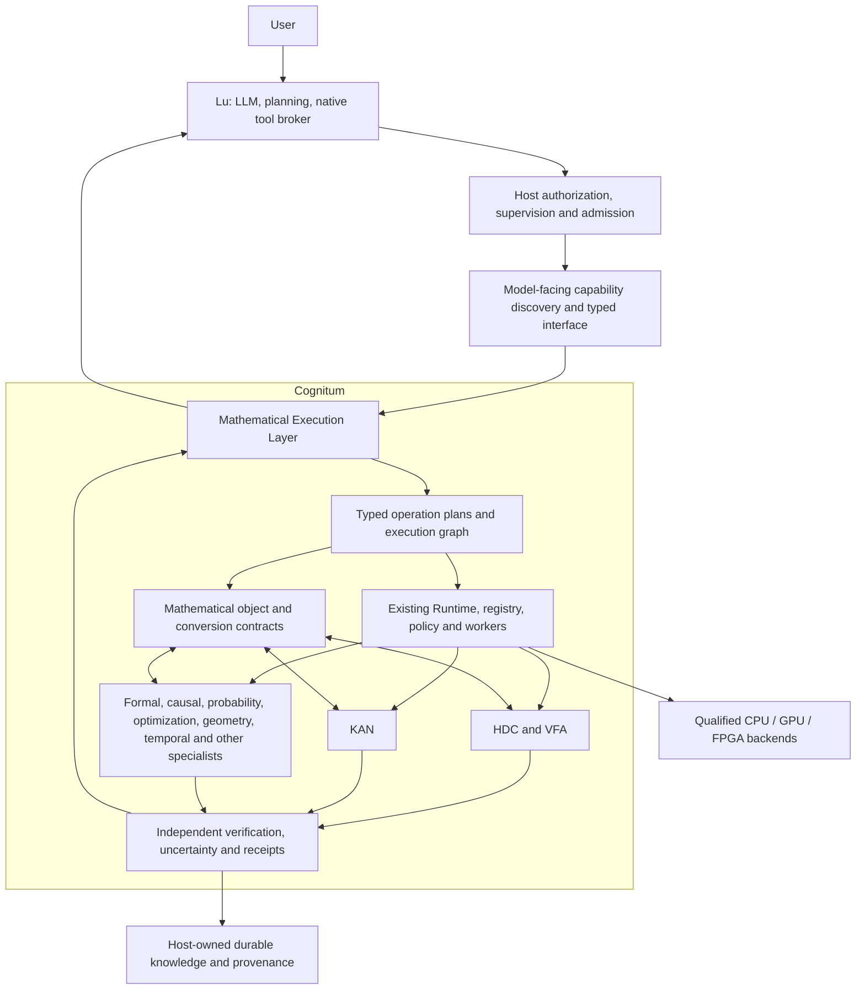

# Cognitum — Mathematical Execution Layer (MEL)

**Architecture specification and engineering directive | Version 0.1 | November 18, 2026**

**Status:** Proposed design for reconciliation and implementation; not a declaration of installed or production-ready functionality.

**Scope:** Cognitum, its HDC and KAN mathematical engines, established mathematical specialists, and model-facing integration through Lu. Companion to the *Cognitum — HDC & KAN Master Mathematical Capability Register* (H1–H60, K1–K60, 24 shared mathematical instruments, I-01–I-20).

## 1. Purpose and governing directive

Cognitum shall provide a unified, mathematically rigorous execution environment in which an AI model can discover, request, compose and evaluate the capabilities of independent mathematical engines. HDC and KAN shall remain first-class computational subsystems, not merely fixed-purpose classifiers or regression plugins.

The Mathematical Execution Layer (MEL) shall connect models, mathematical objects, engines, conventional solvers, verification and persistent knowledge through a common execution contract. It shall extend Cognitum's existing runtime rather than create an unrelated second execution system.

The objective is to investigate genuine improvements in AI capability, reliability and efficiency through mathematical cooperation. Neither the presence of these engines nor their integration establishes general intelligence, awareness or superiority over existing methods. Such claims require independent evidence.

### Non-negotiable principles

- Preserve HDC and KAN as independent mathematical engines, including their overlapping capabilities and native representations.
- Use mature conventional mathematical tools where they are appropriate; do not require HDC or KAN to replace exact solvers, formal logic, or causal inference.
- Prefer explicit typed tool execution before pursuing neural or latent-space integration. The first implementation shall not require LLM weight modification or retraining.
- Keep Lu responsible for user and model authorization, tool exposure, policy, canonical memory and host-supervised execution. Neither model output nor a Cognitum capability proposal grants authority.
- Keep research routes disabled by default; require explicit scoped admission and independently qualified operations. No automatic production promotion.
- Prefer mathematical fidelity and measurable benefit over architectural novelty. Accept negative results, conditioning failures, ambiguity and unsupported operations as valid outcomes.
- Build CPU-first reference implementations, then qualify GPU and FPGA backends independently. Preserve exact semantics, cancellation, provenance and error disclosure across platforms.

## 2. Existing implementation and identified gap

Baseline reviewed: Cognitum development commit [`934fcda26ac54856675db50fd9e7fa4986424e9a`](https://github.com/vjmichael/cognitum/commit/934fcda26ac54856675db50fd9e7fa4986424e9a); corresponding [native acceptance run 44443339840](https://github.com/vjmichael/cognitum/actions/runs/44443339840), 18/18 jobs successful, including VFA-01/02/03 gates on Windows and Linux under Python 3.11 and 3.13. This is scoped research acceptance, not acceptance of MEL.

| Existing source | Role and limitation |
|---|---|
| `cognitum/registry.py` | Trusted registration and resolution; research requires an enabled entry and explicit research permission. |
| `cognitum/runtime.py`, `policy.py`, `worker.py`, `tracing.py` | Request admission, execution and tracing; extend these contracts and protected execution rather than duplicate them. |
| `cognitum/cooperative.py` | Bounded, host-admitted graph execution with dependency and result checks. Current graph admission excludes research (`allow_research` must be false). |
| `cognitum/cooperative_compositions.py` | Existing typed compositions and independent checks; useful precedent for mathematical bridges. |
| `cognitum/capability_route_proposal.py` | Reviewed capability metadata and proposals; does not register, authorize or execute tools. |
| `cognitum/research/hdc_optional.py`, `hdc_canonical.py` | Bounded HDC candidate retrieval and canonical verification; not general HDC execution. |
| `cognitum/research/kan_optional.py`, `kan_portable.py`, `kan_approval.py` | Bounded portable spline/RBF checkpoint inference with integrity/approval controls; not comprehensive trainable KAN or a general host route. |
| `cognitum/research/vfa_random.py`, `vfa_periodic.py`, `vfa_rkhs.py`, `vfa_multivariate.py` | Accepted scoped mathematical reference kernels; no general model-facing execution or interchange contract. |
| `cognitum/scientific_math.py`, `formal_*`, `probability_*`, `causal_specialists.py`, `optimization*`, `spatial_*`, `topology_*`, `temporal_*` | Existing conventional or specialist mathematics that may be reused through individually qualified typed operations. |

The gap is not the absence of a runtime. It is the absence of a broad, mathematically typed, safely admitted operation and object layer that connects new HDC/KAN kernels to that runtime, to each other and to an actual AI model.

Research status must remain distinct from implementation availability, native test completion, approved model-facing exposure and demonstrated end-to-end benefit. The master mathematical capability register is a requirements inventory, not an implementation manifest.

## 3. Target architecture

The diagram is logical, not a deployment topology. The initial implementation should reuse the existing runtime and cooperative graph with explicit host-admitted research execution, not introduce a second registry, policy engine or scheduler. Separate processes or hardware workers are implementation choices subject to profiling, security and qualification.

## 4. Common mathematical object system

A mathematical object is a typed, immutable, versioned reference to a mathematical representation together with its semantic and evidentiary context. It is not merely an array, a text description or an LLM embedding. A common envelope shall preserve native data and permit explicit conversion only when semantics are defined.

| Object kind | Representative encodings |
|---|---|
| Scalar / number | Integer, rational, interval, float, residue representation |
| Vector / matrix / tensor | Dense, sparse, packed, complex, tensor factorization |
| Function / field | VFA Fourier coefficients, Gaussian sections, KAN basis expansion or network, symbolic expression, interpolation |
| Operator / transformation | Linear map, differential or integral operator, kernel, learned operator |
| Concept / structured observation | Hypervector with codebook identity, canonical record, feature vector |
| Relationship / graph | Bound role–filler structure, typed relation, graph edge or subgraph |
| Distribution / uncertainty | Parametric distribution, samples, probability intervals or calibrated predictions |
| Hypothesis | Structured proposition, assumptions, supporting evidence and counterevidence |
| Dynamical system | ODE, SDE, state-space model, learned dynamics, initial/boundary conditions |

### Object envelope (proposed fields; not an existing wire schema)

| Field | Required meaning |
|---|---|
| `object_id`, `revision`, `content_digest` | Immutable identity, version and verified content |
| `kind`, `representation`, `schema_version` | Object type and precise encoding contract |
| `domain`, `codomain`, `shape`, `units` | Mathematical meaning, dimensions, valid inputs and outputs |
| `parameters`, `basis_id`, `codebook_id` | Basis, kernel, coordinate frame or codebook compatibility, as relevant |
| `numeric_format`, `precision` | Numeric representation and arithmetic assumptions |
| `assumptions`, `limitations` | Regularity, domain exclusions, closure and validity conditions |
| `assurance`, `error_descriptor` | Exact/approximate status, named norm, error bound, statistical conditions, or unqualified error |
| `source_refs`, `lineage`, `producer` | Parents, operations, source revisions, model/checkpoint identity and build |
| `payload_ref` | Bounded inline value or host-managed content reference; never an arbitrary filesystem path from a model |

Required fields depend on mathematical object type. Non-applicable metadata shall be explicitly distinguished from missing or unqualified information. Handle lifetimes, authorization, digest verification and revision invalidation must be specified. Canonical persistent history belongs to Lu/ANSF; Cognitum may maintain bounded derived caches under that ownership.

### Conversion rules

- A conversion is an operation in its own right, with source/target representations, a validity domain, error/uncertainty semantics and provenance.
- Do not silently equate HDC binding with pointwise function multiplication or approximate associative matches with logical facts.
- Do not silently convert incompatible RKHS widths, codebooks, units or coordinate systems. Use an explicit qualified conversion, or refuse.
- KAN-to-VFA and VFA-to-KAN conversion shall compare held-out values and, when requested, derivatives/integrals; preserve information about approximation and truncation.
- Use references to full mathematical objects internally instead of repeatedly serializing all coefficients into LLM context. The model receives concise typed summaries, evidence and handles; authorized inspection remains possible.

## 5. Capability and operation contracts

Each engine publishes reviewed operation descriptors. Discovery is read-only. An operation becomes callable only after trusted registration, qualification and host authorization. A descriptor should declare:

- Stable operation ID, version, engine and purpose; input/output schemas and supported representations.
- Domain assumptions, preconditions, postconditions, closure and resource limits.
- Determinism and randomness/seed controls, precision, approximation semantics and available independent checks.
- Dependencies, permissible backends, research/production track, read/write effects, and required scope of consent.
- Expected runtime/memory limits, cancellation requirements, and explicit error/refusal conditions.

Initial examples (illustrative operation IDs, not already installed tools): `hdc.bind`, `hdc.factorize`, `vfa.evaluate`, `vfa.gradient`, `vfa.compose`, `kan.evaluate`, `kan.fit`, `convert.kan_to_vfa`, `verify.function_equivalence`, `formal.check_constraint`.

### Reusable invocation pattern

1. Model or approved deterministic planner proposes a typed task, with inputs and objective.
2. Lu checks the capability, operation, user intent, data boundaries and per-turn authorization. Model text never grants permission.
3. Cognitum resolves a reviewed descriptor, checks object digests, representation compatibility, assumptions and quotas, and admits a bounded operation or graph.
4. An existing supervised worker executes the qualified kernel. Parent results and object references are passed to subsequent admitted nodes without unnecessary model round trips.
5. Independent checks validate outcomes and uncertainty; ambiguous or invalid results are refused or explicitly labeled. No partial graph output is promoted to a verified final result.
6. Return typed results, evidence and receipt to the model. Persist only through authorized host-owned storage pathways.

### Assurance and result receipts

Do not conflate exact arithmetic, certified enclosures, conditional statistical guarantees and empirical validation. Proposed assurance classes include `EXACT_UNDER_ASSUMPTIONS`, `CERTIFIED_NUMERICAL_ENCLOSURE`, `CONDITIONAL_STATISTICAL_BOUND`, `EMPIRICALLY_VALIDATED`, `UNQUALIFIED_APPROXIMATION`, `AMBIGUOUS`, `REFUSED` and `CANCELLED`. These are descriptive proposed labels, not current enum values. A result may have multiple complementary assurance statements; exactness under stated assumptions is not a claim of real-world truth.

A receipt records operation/version, source build, input/output digests, representation and domain, backend/precision, seed/checkpoint if relevant, verification procedure and outcome, error metadata, resource use, admission identity and terminal state. Independent verification is mandatory for claims of certification; benchmark agreement is not a formal certificate. No silent fallback or implicit certainty upgrade.

## 6. Cooperative mathematical execution

MEL should support bounded directed acyclic execution graphs initially, reusing the existing cooperative plan and admission mechanisms. Typed bridges validate inputs and outputs. Independent nodes may run concurrently within resource budgets; dependencies are explicit. Any future iterative solver or recurrent orchestration must use bounded steps, termination and separate qualification. Unbounded self-directed execution is not part of the initial design.

The first research graph must admit only a reviewed set of deterministic or seeded operations explicitly authorized by the host. Do not simply remove the existing cooperative research exclusion. Add a narrowly scoped admission path preserving the original strict non-research behavior, current-source checks, cancellation and publication gates.

### Example A — learning a mathematical relationship

| Step | Participant | Proposed operation |
|---|---|---|
| 1 | HDC | Structure observations, associate related concepts and recover candidate patterns |
| 2 | KAN | Fit candidate functional relationships on a declared training set |
| 3 | VFA | Convert or approximate compatible functions; evaluate, compose, differentiate or integrate |
| 4 | Conventional baseline | Fit or solve the same task with an appropriate established method |
| 5 | Causal and formal specialists | Evaluate causal identifiability assumptions, constraints and counterexamples |
| 6 | Verification / LLM | Compare evidence, disclose limitations, suggest next investigations |

Predictive association does not imply causation. Function approximation does not imply symbolic equivalence. Disentanglement or learned structure must be validated against independent observations rather than inferred solely from a low loss.

### Example B — NVP scene continuity (future integration)

HDC may propose identity, appearance, pose and spatial factors; KAN may learn time-dependent motion or deformation functions; established spatial/temporal specialists check continuity and confidence; NVP compares candidate interpretations against authoritative ActorID and OpenUSD data. No inferred identity or scene representation overwrites authoritative data without approved reconciliation. This is a future application, not an implementation commitment to NVP in this phase.

## 7. Two paths to model integration

| | Tool-based / explicit integration | Neural / latent integration |
|---|---|---|
| Interface | Typed requests, handles, operation descriptors, results and evidence | Learned tensor or latent interfaces, adapters or internal representations |
| LLM compatibility | Broad; no model-weight changes normally required | Architecture-dependent; may require training |
| Verification | Explicit operations and reproducible trace | Requires additional representation, training and behavioral evaluation |
| Priority | First; establish an actual end-to-end local-model path | Later experimental work after reference execution is established |

An LLM may request an entire approved mathematical workflow rather than direct every elementary operation. This does not imply autonomous authority, unrestricted network/file access or permission to execute model-generated code. Use typed operations and host-verified plans; distinguish inference, fitting/training, persistence and external side effects.

## 8. Security, lifecycle and performance

- Host-controlled, per-turn capabilities; trusted engine installation; no privilege escalation through data, mathematical objects, model text or routing proposals.
- Preserve the existing OS worker custody, cancellation, restart, source freshness, budget and recovery protections. Bind object handles to authorized scope; stale or revoked handles must fail closed.
- Use bounded schemas and payloads; validate shape, finiteness, numeric range and domains. Resource limits cover allocations, execution duration, process ownership, graph depth, iteration count and artifact sizes.
- Keep training/checkpoint approval separate from inference; verify artifact digests, license/provenance and authorization before use. Never load executable pickle or untrusted native code as mathematical data.
- No unapproved network egress. Explicitly protect private observations, derived representations and persistent knowledge; audit export and persistence separately.
- Define safe cancellation and terminal receipts. A crash or cancellation must not silently replay creator-authorized work or publish a partially verified graph.
- CPU is the reference lane. Device selection must use verified capability/precision/resource information. GPU/FPGA execution requires matched numerical and lifecycle tests. Record the real backend, transfers, memory, latency and energy only where measured.
- Do not force HDC, KAN or any experimental backend into every task; select by actual mathematical applicability and measured workload. Preserve conventional fallback as an explicit, independently recorded route.

## 9. Relationship to the master register

Preserve the original 85-entry HDC research register and the new 164-group capability register. Maintain a many-to-many mapping from each group to operation contracts, source modules, independent tests, benchmark receipts, research constraints, and eventual model-facing eligibility.

All 20 interoperability targets (I-01–I-20) shall have explicit disposition and ownership. Group them for implementation but do not erase individual targets. A shared conventional solver is not evidence that either HDC or KAN implements that capability natively. Likewise, a locally tested kernel is not evidence of UI access, authorization, end-to-end efficacy or physical execution.

Add separate lifecycle dimensions: **specified → source present → scoped verification → cross-platform acceptance → model-admitted research → measured cooperative benefit → approved production**, with historical/partial/negative/unsupported states as applicable. Advancement requires evidence appropriate to the stage, not merely source or an unrelated green run.

## 10. Proposed implementation ledger

These work packages are proposals to reconcile against the authoritative master ledger; do not duplicate existing accepted work.

| ID | Objective | Required acceptance |
|---|---|---|
| MEL-01 / COG-MATH-00 | Audit runtime, registry, cooperative graph, host handoff and master register. Establish boundaries and operation IDs. | Exact-source coverage map; preserved 85 and 164 inventories; architecture decision record; no duplicate runtime or research promotion. |
| MEL-02 | Typed mathematical object envelope, schema validation, immutable handles, identity/version and representation metadata. | Round-trip parity, malformed/oversized inputs, units and basis incompatibility refusal, lifecycle/authorization negative tests. |
| MEL-03 | Model-facing capability descriptors and host admission. | Model can discover reviewed operations, but cannot register or authorize them; unsupported and unauthorized requests fail closed. |
| MEL-04 | Cross-engine graph execution and approved bridge contracts. | Independent single-engine and cooperative results agree within declared bounds; lineage and resource limits preserved; stale/cancelled graphs cannot publish. |
| MEL-05 | Verification and error propagation. Reuse VFA-04 and existing verified numerical tools. | Distinguish exact/certified/statistical/empirical results; adversarial numerical cases and independent checks; no unsupported certainty. |
| MEL-06 | Genuine local LLM-to-engine acceptance through Lu's approved native execution path. | Model discovers, selects and invokes a reviewed operation, receives verified result and correctly interprets or refuses it; no synthetic tool-result substitution; matched baseline and resource measurements. |
| MEL-07 | CPU/GPU/FPGA routing, staged qualification and operational scale. | Bit/numerical fidelity under declared precision, actual measured device execution, bounded resources, cancellation/recovery and explicit fallback. |

### First vertical slice (recommended)

Do **not** wait until all HDC/KAN mathematical research is complete to test integration. After MEL-01's design audit, establish a minimal end-to-end path using already accepted CPU mathematics: a bounded VFA object with evaluation and gradient operations, a formal or independent numerical verification step, and a real local model using a host-approved tool call. Add the existing portable KAN evaluator under checkpoint approval, then a bounded HDC/KAN functional exchange pilot as the relevant representations are qualified. This sequence reduces integration risk without delaying every independent research workstream.

Continue VFA-04 and COG-04 on the established mathematical foundations, aligning each new engine operation with stable contracts as they mature. Avoid requiring premature hardware implementation, neural retraining, or broad production registration for basic research acceptance. Preserve the existing single development line and consolidated CI policy; reconcile running jobs before publishing a replacement candidate.

## 11. Acceptance and scientific evaluation

The goal is verified usefulness, not a count of tools or a count of green tests.

| Test family | Required evidence |
|---|---|
| Mathematical fidelity | Known analytic results, independent implementations, exact or verified numerical checks, sensitivity/domain tests |
| Interoperability | Representation compatibility, conversion fidelity, valid lineage and composition; refusal of invalid bridges |
| Execution integrity | Authorization, cancellation, crash recovery, replay resistance, resource caps, source/version integrity |
| Actual model behavior | Genuine local LLM tool discovery, calls, multi-engine workflows, result understanding and abstention |
| Comparative efficacy | Same task/data/model and matched budgets: unassisted LLM, conventional solver tools, HDC-only, KAN-only, cooperative engines where appropriate |
| Performance | Accuracy, robustness, latency, memory, training/inference costs and energy if measured; separate overhead from kernel cost |
| Release eligibility | Exact-head Windows/Linux acceptance, protected installed host execution, owner approval; GPU/FPGA only when qualified |

Record task-level failures and negative findings. A narrow retrieval loss does not falsify all HDC mathematics; a successful surrogate does not validate every KAN architecture; a cooperative result does not by itself establish an improvement over conventional methods.

## 12. Engineering directive and boundaries

**Cognitum shall develop mathematical execution as a first-class architectural concern.** All new HDC and KAN mathematical operations should be designed with typed inputs/outputs, explicit assumptions, resource limits and independently verifiable results. Mathematical object exchange and model invocation shall become standard integration obligations as operations mature.

The immediate task is **COG-MATH-00 / MEL-01 — Establish the unified mathematical execution architecture and reconcile the master capability register against the existing runtime.** Follow with a small real end-to-end integration slice, then expand the execution contracts alongside the mathematical research.

This specification is a proposed design, not a source patch, an implemented model integration or an approval to enable research routes. It makes no changes to Cognitum, Lu or NVP. Final operation schemas, execution placement and promotion criteria must be reconciled with the exact current source and verified during the respective engineering tasks.
